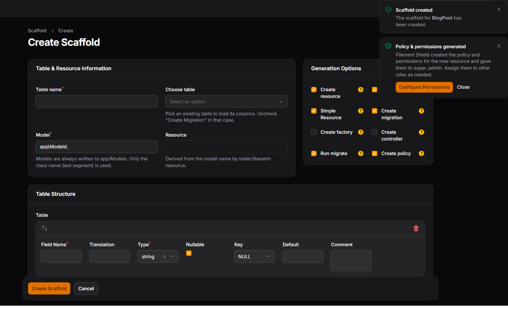

# Filament Scaffold 2

[](https://packagist.org/packages/emmanpbarrameda/filament-scaffold2)
[](https://packagist.org/packages/emmanpbarrameda/filament-scaffold2)

## Description
Filament Scaffold 2 is a toolkit for **Filament v4 and v5** that simplifies the generation of resources. Fill in one form inside your panel and it generates the migration, model, factory, Filament resource, controller, route, Shield policy and API service for a table. It aims to speed up development and reduce the time spent writing repetitive code.

> [!NOTE]
> Filament Scaffold 2 is a rebuild of [solution-forest/filament-scaffold](https://github.com/solutionforest/filament-scaffold), which supports Filament v3 only. It adds a new generation flow, validation of every generated name, and optional Shield and API integrations. See [Credits](#credits).

## Features
- **Automatic Filament Resource Generation**: the migration runs first, then `make:filament-resource --generate` builds the form and table from the real database columns, in the v4/v5 resource layout (Resource + Schemas + Tables + Pages).

- **Support for Multiple Resource Types**: generates the migration (and runs it), model, factory, Filament resource, controller, route, Shield policy and API service.

- **New or Existing Tables**: design the columns in the form (including enum values, nullable, default, unique/index and comments), or pick an existing table to load its columns.

- **Any Database**: table introspection uses Laravel's Schema builder (MySQL, MariaDB, SQLite, PostgreSQL).

- **Safe by Default**: disabled unless you enable it, never overwrites existing models or policies, and rejects names that aren't valid PHP/SQL identifiers before writing anything.

- **Optional Integrations**: [Filament Shield](https://github.com/bezhanSalleh/filament-shield) policies and permissions (created by `shield:generate`, so they follow your Shield config) and [Filament API Service](https://github.com/rupadana/filament-api-service) endpoints. These options only show when the packages are installed.

## Requirements
- PHP 8.2+
- Laravel 11, 12 or 13
- Filament v4 or v5

## Installation
Install it as a **dev** dependency. The Scaffold Manager writes PHP files to your project and must never be reachable in production.

```bash
composer require emmanpbarrameda/filament-scaffold2 --dev
```

Then, make sure your database connection is set in the `.env` file.

In your project, `app/Providers/Filament/xxxPanelProvider.php`, add the plugin:

```php
use Emmanpbarrameda\FilamentScaffold2\FilamentScaffoldPlugin;

public function panel(Panel $panel): Panel
{
    return $panel
        // ...
        ->plugins(array_filter([
            class_exists(FilamentScaffoldPlugin::class) ? FilamentScaffoldPlugin::make() : null,
        ]));
}
```

The `class_exists()` check keeps the panel working on servers where dev dependencies are not installed (`composer install --no-dev`).

Enable it in your **local** `.env` only:

```env
FILAMENT_SCAFFOLD2_ENABLED=true
```

## Publishing Configuration file
To publish the configuration file, use:

```bash
php artisan vendor:publish --tag="filament-scaffold2-config"
```

```php
return [
    'enabled' => env('FILAMENT_SCAFFOLD2_ENABLED', false),

    'navigation' => [
        'group' => 'System',
        'icon' => 'heroicon-o-cube-transparent',
        'sort' => 99,
        'label' => 'Scaffold2 Manager',
    ],
];
```

Set `enabled` to `false` (the default) to turn the Scaffold Manager off. When it is off, the page is not registered at all.

## Usage
Your panel will have a **System > Scaffold2 Manager** page.

- **New table**: type a table name, add the columns, and keep "Create Migration" and "Run Migrate" checked.
- **Existing table**: pick it in "Choose Table". Its columns are loaded and "Create Migration" is unchecked automatically.

Click **Create Scaffold**. The steps run in this order:

1. Migration, then `migrate`
2. Model
3. Factory
4. Filament resource (`--generate`, so the form and table come from the real columns)
5. Controller and route
6. Cache clear (`optimize:clear` and Filament's cached panel components, so the new resource shows up right away)
7. Shield policy and permissions (`shield:generate` in a separate process, using your `config/filament-shield.php` naming; new permissions go to `super_admin`)
8. API service

Existing model and policy files are never overwritten. If the table already exists, the migration step is skipped with a warning.

> [!NOTE]
> The resource's form and table come from Filament's own `make:filament-resource --generate`, which picks each field and column from the database column type. Review the generated files and adjust labels, relationships and validation as needed.

## Preview



## Changelog

Please see [CHANGELOG](CHANGELOG.md) for more information on what has changed recently.

## Contributing

Issues and pull requests are welcome on [GitHub](https://github.com/emmanpbarrameda/filament-scaffold2). Please describe the Filament, Laravel and PHP versions you are using.

## Security Vulnerabilities

The Scaffold Manager turns form input into PHP files. Keep it disabled outside local development. If you find a security issue, please [open a private security advisory](../../security/advisories/new) instead of a public issue.

## Credits

- [Emmanuel P. Barrameda](https://github.com/emmanpbarrameda): Filament v4/v5 rebuild and maintenance
- [Solution Forest](https://github.com/solutionforest) and the contributors of [solution-forest/filament-scaffold](https://github.com/solutionforest/filament-scaffold): the original package this project is based on
- [All Contributors](../../contributors)

## License

The MIT License (MIT). This project keeps the original copyright notice of solution-forest/filament-scaffold. Please see [License File](LICENSE.md) for more information.
